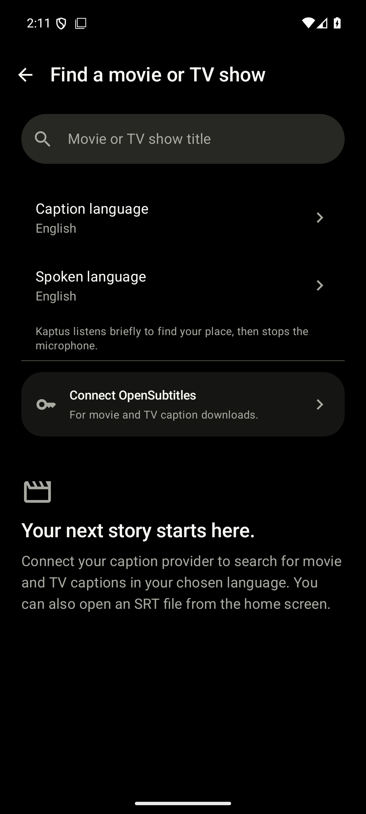
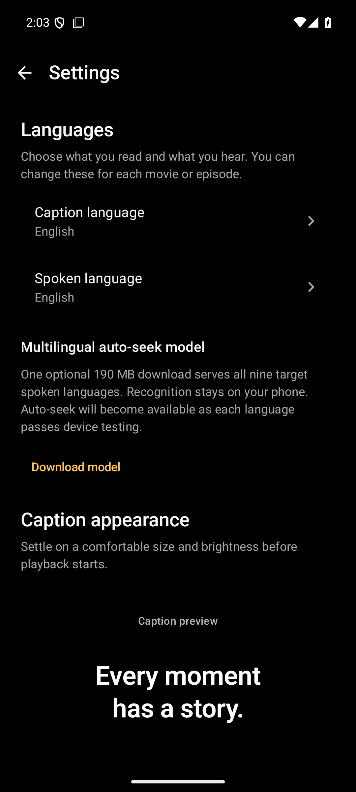

# Multilingual preview verification

Checked on September 30, 2026, for Android `0.3.0-preview`. These are automated and emulator checks, not physical-phone language qualification.

| Check | Result |
| --- | --- |
| Kotlin unit tests | 70 passed |
| Android 16 / API 36 emulator tests | 24 passed |
| Acceptance-report validator | 10 Python tests passed |
| Android lint | No errors, 45 warnings and 2 hints |
| Debug APK | Built, ARM64 and x86_64 included |
| Release APK | Built unsigned, ARM64 included |
| Bundled English and VAD models | Present in both APKs |
| Native 16 KB compatibility | All 6 debug and 3 release libraries passed ELF and APK alignment checks |

Tests cover exact-language ranking and cache isolation, migration of existing movie/episode history, shared-file display/helper roles, Unicode decoding, malformed SRT recovery, split-file rejection, model integrity and interrupted downloads, stale recognition sessions, global ambiguity, helper timing mappings and translated matching. Player regressions cover manual-language microphone gating, backgrounding during delayed resync, clock retention, rotation and large text.

The final parser and provider cleanup was verified by the expanded unit suite and rebuilt APKs. The emulator suite also passed after the new player, language and model-cancellation changes. Native Material screens were inspected on the emulator.

<p>
  
  
</p>

These captures use the API 36 emulator, without a simulated device frame. They show the existing cinema palette and native controls.

No new spoken-language pair is enabled by these results. There were no physical ARM64 phone trials, native-speaker-reviewed accuracy measurements, live-account provider tests or two-hour hardware sessions in this workspace. See [the language matrix and qualification protocol](MULTILINGUAL.md) before enabling a new pair.

Run the checks locally with JDK 17 and Android SDK 36:

```powershell
./gradlew.bat testDebugUnitTest lintDebug assembleDebug assembleRelease connectedDebugAndroidTest
python tools/check_native_load_alignment.py app/build/outputs/apk/debug/app-debug.apk app/build/outputs/apk/release/app-release-unsigned.apk
python -m unittest discover -s tools -p test_validate_language_trials.py
```
